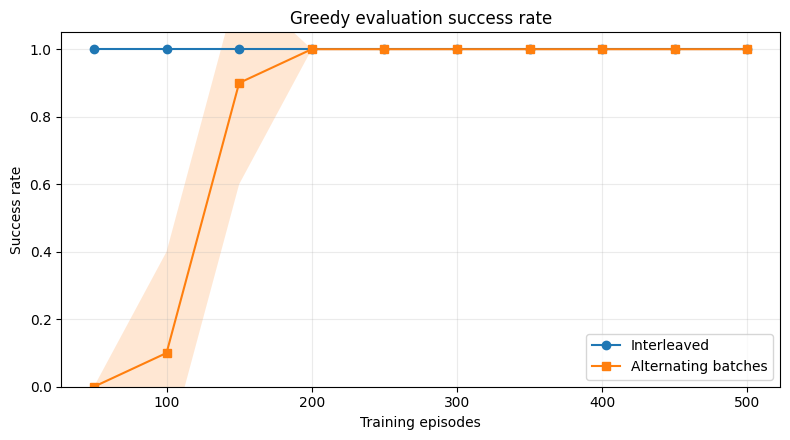
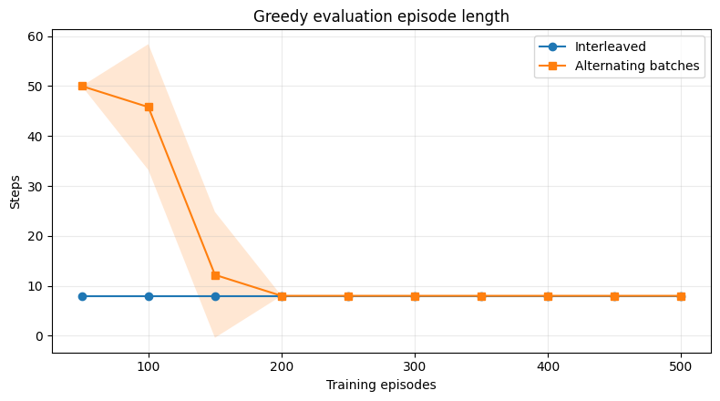
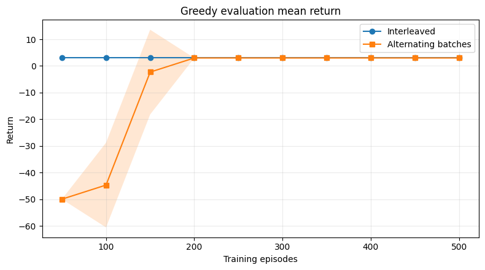
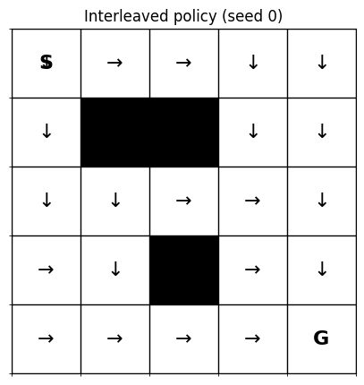

# Generalized Policy Iteration: A Tiny GridWorld Experiment

A multi-seed experiment illustrating Generalized Policy Iteration (GPI) through two different Q-learning update schedules in a deterministic 5×5 GridWorld.

**[Kaggle Notebook](https://www.kaggle.com/code/sarraverse/gpi-gridworld-multiseed?scriptVersionId=365234930)** · **[Portfolio Article](YOUR_PORTFOLIO_ARTICLE_URL)**

## Motivation

This experiment was inspired by a passage in Richard Sutton and Andrew Barto's *Reinforcement Learning: An Introduction*:

> "[GPI refers] to the general idea of letting policy evaluation and policy improvement processes interact, independent of the granularity and other details of the two processes. Almost all reinforcement learning methods are well described as GPI."

I wanted to explore this idea through a small practical example: what happens when value updates and policy changes are scheduled at different frequencies?

The experiment compares two Q-learning update schedules. Both learn from the same environment, but they differ in when Q-values are updated and how frequently the behavior policy can adapt.

## Environment

The experiment uses a deterministic 5×5 GridWorld.

- **Start:** `(0, 0)`
- **Goal:** `(4, 4)`
- **Blocked cells:** `(1, 1)`, `(1, 2)`, `(3, 2)`
- **Actions:** Up, down, left, right
- **Step reward:** `-1`
- **Goal reward:** `+10`
- **Maximum episode length:** `50` steps

The shortest successful route takes eight moves, producing a return of `+3`.

### Environment layout


## Methods

Both approaches use tabular Q-learning with the same environment and learning hyperparameters.

### 1. Interleaved updates

The agent updates its Q-values immediately after every transition. Its next action can therefore respond to the latest estimates.

### 2. Alternating batches

At the beginning of each batch, the agent derives a greedy policy from its current Q-values. It then collects ten episodes using that fixed greedy policy with ε-greedy exploration.

After collecting the batch, the transitions are shuffled and used to update the Q-values. The next batch derives a new greedy policy from the updated estimates.

These are two different update schedules, not a comparison between GPI and a non-GPI algorithm.

## Experimental setup

The experiment uses ten random seeds, with 500 training episodes per seed and per method.

| Parameter | Value |
|---|---:|
| Learning rate (`alpha`) | `0.20` |
| Discount factor (`gamma`) | `0.95` |
| Exploration rate (`epsilon`) | `0.10` |
| Training episodes per seed | `500` |
| Number of random seeds | `10` |
| Batch size | `10` episodes |
| Evaluation interval | `50` training episodes |
| Evaluation episodes per checkpoint | `100` |

Both methods are evaluated using their greedy policies, without exploration, at the same training checkpoints.

The evaluation metrics are:

- **Success rate:** proportion of episodes in which the agent reaches the goal.
- **Mean episode length:** average number of steps per episode.
- **Mean return:** average cumulative reward per episode.

The learning curves report the mean and standard deviation across the ten seeds.

## Results

Both methods reached the same final performance.

| Metric | Interleaved updates | Alternating batches |
|---|---:|---:|
| Mean return | `3.00 ± 0.00` | `3.00 ± 0.00` |
| Mean episode length | `8.00 ± 0.00` | `8.00 ± 0.00` |
| Success rate | `100.0% ± 0.0%` | `100.0% ± 0.0%` |

These are means and standard deviations across ten seeds. Each final policy was evaluated over 100 episodes per seed.

### Learning curves

**Success rate**



**Mean episode length**



**Mean return**



### Learned policies

The following figure compares the learned greedy policies for one seed.



Both methods eventually learned the shortest route in this environment. Their identical final metrics do not, by themselves, establish that their learning trajectories or sample efficiency were identical.

## Understanding the results

The experiment illustrates how value updates and behavioral adaptation can happen at different frequencies.

- With interleaved updates, Q-values are updated after every transition, allowing subsequent actions to respond to the latest estimates.
- With alternating batches, the behavior policy is derived at the beginning of each batch and remains fixed during that collection phase, while Q-value updates happen after the batch.

Neither schedule should be expected to outperform the other in every environment. The outcome depends on the environment, exploration strategy, hyperparameters, and implementation details.

### A technical note on Q-learning and GPI

Q-learning is an off-policy control algorithm. Its update target uses the maximum estimated action value at the next state:

```text
Q(s,a) <- Q(s,a) + alpha * [
    r + gamma * max_a' Q(s',a') - Q(s,a)
]
```

It is therefore not equivalent to explicitly evaluating a fixed policy using a policy-evaluation algorithm. This experiment uses Q-learning as a compact value-based illustration of the interaction between value learning and policy improvement, rather than as a direct implementation of classical policy iteration.

## Limitations

This is an intentionally small experiment:

- The environment is deterministic and tabular.
- Only one map and reward design are considered.
- The two schedules differ in both update timing and within-batch policy behavior.
- Ten random seeds provide a more informative picture than a single run, but do not establish a universal performance ranking.
- The results should not be generalized directly to deep reinforcement learning or more complex environments.

## Running the notebook

You can execute the experiment directly on Kaggle:

[Open the Kaggle notebook](https://www.kaggle.com/code/sarraverse/gpi-gridworld-multiseed?scriptVersionId=365234930)

To run it locally:

1. Clone this repository.
2. Install the notebook's dependencies.
3. Open `notebook/gpi_gridworld_multiseed.ipynb` in Jupyter Notebook or JupyterLab.
4. Run the cells in order.

The notebook contains the environment implementation, training procedures, multi-seed evaluation, and visualization code.

## Reference

Sutton, R. S., & Barto, A. G. (2018). *Reinforcement Learning: An Introduction* (2nd ed.). MIT Press. Chapter 4: Dynamic Programming.

[Official book website](https://incompleteideas.net/book/the-book-2nd.html)

---

This repository is an educational experiment intended to make a foundational reinforcement learning concept more concrete.
